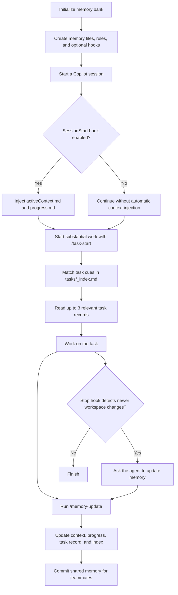

# Copilot Memory Bank

Persistent project memory for GitHub Copilot in VS Code. Initialize a repo to create its memory files and Copilot rules. Commit the shared files so teammates can use them after installing the extension. No manual file copying.

## What you get

| Piece | How it is delivered |
|---|---|
| `/memory-init`, `/memory-update`, `/task-start`, `/memory-prune` | Prompts bundled with the extension; available in Copilot Chat after the extension is installed |
| Memory rules | Bundled instructions, active in workspaces that have a `memory-bank/` folder |
| `memory-bank/` | Five core files, task index and template, and decision-record template created by **Memory Bank: Initialize** |
| `.github/copilot-instructions.md` | Created from the bundled instructions; an existing file is left unchanged |
| Optional agent hooks | Written to `.github/hooks/` by **Memory Bank: Initialize**; load current notes at session start and ask the agent to update memory when workspace files change |

## Automatic read / update (hooks)

Initialize writes three files into `.github/hooks/`:

- `memory-bank.json` registers the hooks.
- `memory-session-start.js` (SessionStart) injects `activeContext.md` and `progress.md` into the conversation.
- `memory-stop-check.js` (Stop) checks whether changed files outside `memory-bank/` are newer than `activeContext.md`. If so, it asks the agent to update memory before finishing. A loop guard prevents repeated blocks, and the hook skips non-Git folders.

Hooks need VS Code's `chat.useHooks` setting, a trusted workspace, and Node.js on `PATH`. A blocked stop may take one extra agent turn. Commit `.github/hooks/` for teammates to use the same hooks. Turn them off with `memoryBank.installHooks = false`.

Memory files: `projectbrief.md`, `techContext.md`, `systemPatterns.md`, `activeContext.md`, `progress.md`, `tasks/_index.md`, `tasks/0000-template.md`, and `decisions/0000-template.md`. `/task-start` creates a record for substantial work. The index helps find related past tasks without loading every record. `/memory-update` records the result and updates the index.

## How memory works



## Install

1. Download `copilot-memory-bank-0.3.0.vsix`. Do not double-click it or open it in the editor; that shows it as text.
2. VS Code: Extensions view, `...` menu, **Install from VSIX...**, or run `code --install-extension copilot-memory-bank-0.2.0.vsix`.
3. Requires VS Code 1.115 or later and GitHub Copilot Chat.

## Use

1. Open a project. Accept the "Set up a Copilot memory bank?" prompt (or run **Memory Bank: Initialize**).
2. Copilot Chat opens with `/memory-init` pre-filled; send it and Copilot fills the templates from your code. Review and commit.
3. For substantial work, start with `/task-start`. It checks the task index and reads only a few related records. Finish with `/memory-update` to record verified results and update the index. Review memory changes in pull requests like code.
4. Occasionally run `/memory-prune`.

After upgrading an existing installation, run **Memory Bank: Initialize** again to add the task index and template. Existing files are left unchanged.

## VS Code commands

- **Memory Bank: Initialize** creates missing memory files and optional integrations.
- **Memory Bank: Open Active Context** opens the current-work notes.
- **Memory Bank: Add Decision Record** creates a numbered note explaining a choice.

## Teammates

Initialize adds this extension to `.vscode/extensions.json`, so anyone opening the repo is prompted to install it.

## Settings

| Setting | Default | Purpose |
|---|---|---|
| `memoryBank.promptOnOpen` | true | Offer setup when a trusted workspace has no memory bank |
| `memoryBank.gitignoreActiveContext` | false | Add `activeContext.md` to `.gitignore` during setup for per-developer notes |
| `memoryBank.installHooks` | true | Write SessionStart and Stop hooks to `.github/hooks/` |
| `memoryBank.recommendExtension` | true | Add this extension to `.vscode/extensions.json` |
| `memoryBank.runInitPromptAfterScaffold` | true | Open Copilot Chat with `/memory-init` after files are created |

Existing files are never overwritten.

## Build from source

```bash
npm install
node --test test/scaffold.test.js
npm run package
```

Change `publisher` in `package.json` to your own publisher ID before publishing to a marketplace or private gallery.
